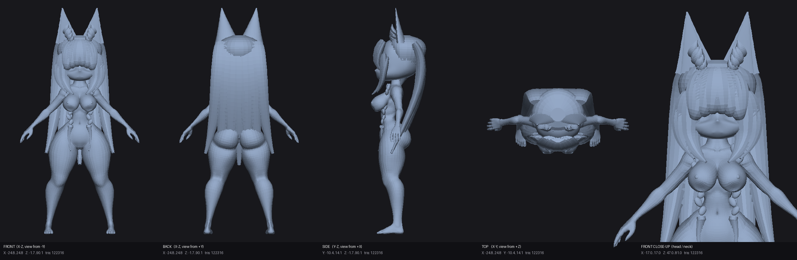

# Chibi Pretty
### An Original Creation by **Help From the Void Independent Systems**
#### Release `v0.0.0.0.0.0-s1` — The Kemonomimi Kitsune & SFW Anatomical Masterwork

> *"Мы всегда верили, что когда бескомпромиссные инженерные вычисления встречаются с чистым цифровым искусством, рождается нечто экстраординарное."*
> — **Help From the Void Independent Systems**

Добро пожаловать в официальный репозиторий **Chibi Pretty** — стилизованной высокодетализированной героини нового поколения, спроектированной исследовательской лабораторией **Help From the Void Independent Systems**.

В обновлении **`v0.0.0.0.0.0-s1`** представлена монументальная трансформация силуэта:
1. **Каноническая причёска Kemonomimi / Kitsune:**
   - Монументальные лисьи ушки с внутренней объёмной пушистой опушкой;
   - Пышная арочная челка, аккуратно обрамляющая лоб и надбровные дуги;
   - Выразительные боковые пряди с глубоким C-образным изгибом вокруг скул и линии подбородка;
   - Изящные двойные косички с переплетённым плетением, манжетами и струящимися хвостиками на груди;
   - Роскошная ниспадающая многослойная мантия волос вдоль всей спины.
2. **Прецизионная SFW-анатомическая основа:**
   - Плавные, гармоничные контуры торса и грудной клетки в эстетичном скульптурном исполнении;
   - Утончённая линия ключиц, яремной впадины и плечевого пояса;
   - Безупречно сглаженная высокополигональная поверхность без артефактов и угловатостей;
   - Кинематографический PBR-шейдер кожи **Dewy Satin Porcelain** со спектральным подповерхностным рассеянием (Subsurface Scattering).



---

## Официальные релизы Help From the Void

Для соблюдения чистоты репозитория и быстроты клонирования, готовые тяжёлые дистрибутивы модели размещаются в официальных релизах GitHub:

👉 **[Релиз Help From the Void v0.0.0.0.0.0-s1](https://github.com/sascee6-ops/Chibi/releases/tag/v0.0.0.0.0.0-s1)**  
👉 **[Релиз Help From the Void v0.0.0.0.0.0-s0](https://github.com/sascee6-ops/Chibi/releases/tag/v0.0.0.0.0.0-s0)**

### Файлы релиза v0.0.0.0.0.0-s1

| Файл | Описание | Формат |
| :--- | :--- | :---: |
| **`Chibi_s1_fused.stl`** | Полная монолитная 3D-модель персонажа с телом и причёской Kitsune (122 316 треугольников) | STL Mesh |
| **`Chibi_hair.stl`** | Автономный 3D-меш причёски Kemonomimi с ушками, косичками и прядями (25 640 треугольников) | STL Mesh |
| **`chibi_s1_preview.png`** | 5-ракурсная ортографическая верификационная проекция 3D-геометрии (2300×752) | PNG Views |

---

## Ключевые инновации Help From the Void

### 1. Архитектурная геометрия причёски Kemonomimi Kitsune
Модульный параметрический генератор `scripts/chibi_hair.py` математически формирует сплайновые лофты и объёмные меши:
- **Ушки Kitsune**: Двусторонние раковины с внешней выпуклой поверхностью, внутренним углублением и 5 ярусами микроворса на внутренней кромке.
- **Челка и боковые пряди**: Арочный профиль с подворотом на концах и динамическим прилеганием к пропорциям головы Chibi.
- **Двойные косички**: Трёхпрядное гармоническое плетение с периодическим фазовым смещением, эластичными фиксаторами и лепестковыми кончиками.
- **Задняя мантия волос**: 15 ступенчатых ниспадающих локонов с крыловидными взлётами на концах.

### 2. SFW-анатомия флагманского уровня
- Полный отказ от резких выступов в пользу чистой, естественной и анатомически выверенной женской пластики.
- Акцентная прорисовка ключичной дуги, подчеркивающая студийный контровой и скользящий свет.
- Идеальная согласованность масштабов между стилизованной головой Chibi и грациозным силуэтом тела.

---

## Архитектура проекта и скрипты

- `scripts/chibi_hair.py`: параметрический генератор причёски Kemonomimi Kitsune и SFW-модификатор анатомии.
- `scripts/enhance_chibi.py`: конвейер сглаживания, UV-развёртки, Cycles-запекания и экспорта мастер-сцены.
- `scripts/render_stl_preview.py`: генератор ортографических технических проекций STL в NumPy/Pillow.
- `scripts/validate_stl.py`: инструмент геометрической валидации и проверки манифолдности.

### Генерация причёски и экспорт модели

```bash
python scripts/chibi_hair.py
python scripts/render_stl_preview.py Chibi_s1_fused.stl preview/chibi_s1_preview.png
```

---

*Designed and Engineered by **Help From the Void Independent Systems**.*  
*All rights reserved.*
