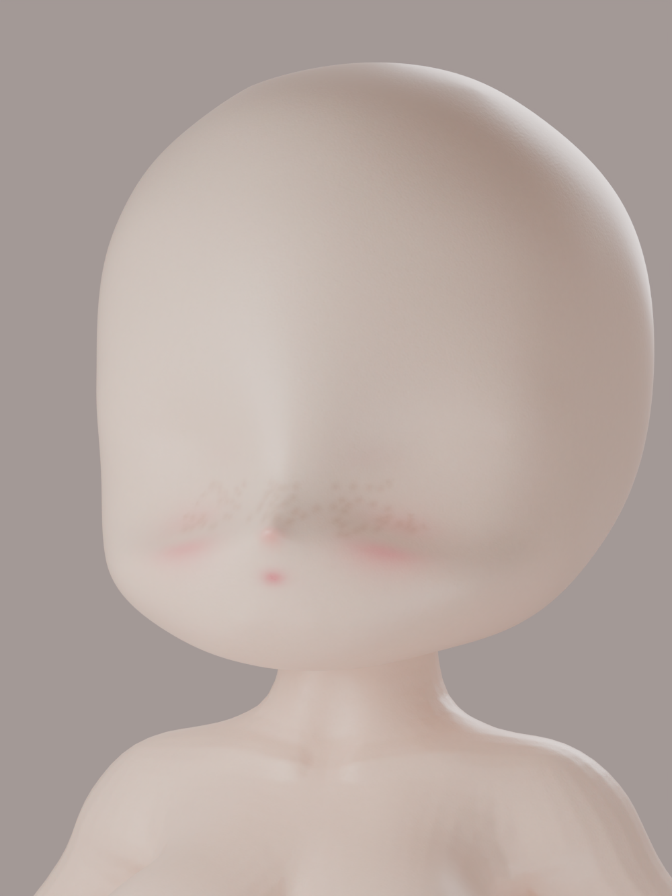
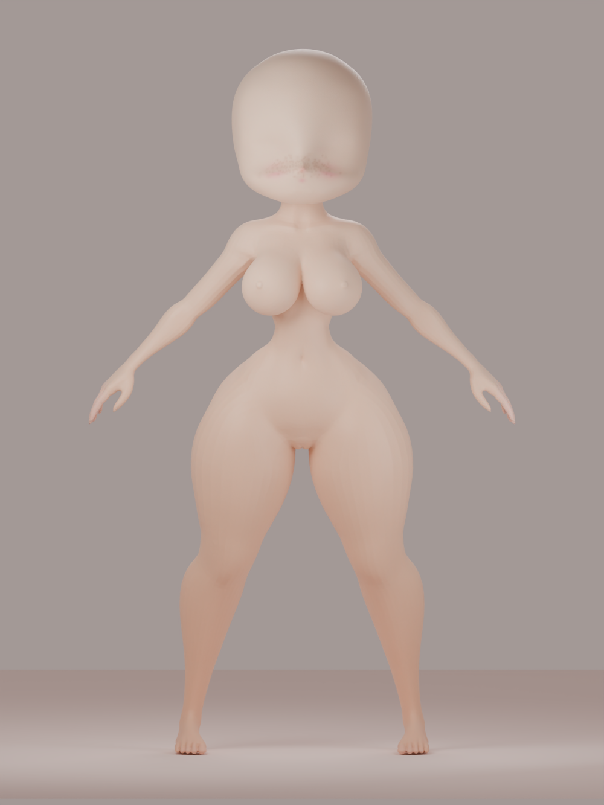

# Chibi Pretty
### An Original Creation by **Help From the Void Independent Systems**
#### Release `v0.0.0.0.0.0-s0` — The Uncompromised Master

> *"Мы всегда верили, что когда бескомпромиссные инженерные вычисления встречаются с чистым цифровым искусством, рождается нечто экстраординарное."*
> — **Help From the Void Independent Systems**

Добро пожаловать в официальный репозиторий **Chibi Pretty** — стилизованной высокодетализированной женской фигуры нового поколения, спроектированной исследовательской студией **Help From the Void Independent Systems**.

В релизе **`v0.0.0.0.0.0-s0`** модель прошла предельно жёсткий, бескомпромиссный цикл переработки: максимальная плотность сетки, кинематографический шейдер **Dewy Satin Porcelain**, честное несжатое 8K-запекание и релизная архитектура нулевого мусора.





---

## Официальный релиз: `v0.0.0.0.0.0-s0`

Для соблюдения чистоты репозитория и предотвращения раздувания Git-дерева сотнями мегабайт бинарных файлов, готовые дистрибутивы модели размещены в официальном релизе GitHub:

👉 **[Перейти к релизу Help From the Void v0.0.0.0.0.0-s0](https://github.com/sascee6-ops/Chibi/releases/tag/v0.0.0.0.0.0-s0)**

### Файлы дистрибутива (Release Assets)

| Файл | Описание | Формат | Ссылка |
| :--- | :--- | :---: | :---: |
| **`Chibi_pretty_8K_Lossless.glb`** | Полная модель с внедрёнными несжатыми 8K PNG текстурами (Base Color, Roughness, Normal) | glTF 2.0 Binary | [Скачать](https://github.com/sascee6-ops/Chibi/releases/download/v0.0.0.0.0.0-s0/Chibi_pretty_8K_Lossless.glb) |
| **`Chibi_pretty.blend`** | Продакшн-сцена Blender 4.2.0 с упакованными 8K PNG мастерами и Cycles AgX светом | Blender Scene | [Скачать](https://github.com/sascee6-ops/Chibi/releases/download/v0.0.0.0.0.0-s0/Chibi_pretty.blend) |
| **`Chibi_pretty.stl`** | Монолитная замкнутая геометрия для высокоточной 3D-печати (837 652 полигона) | Binary STL | [Скачать](https://github.com/sascee6-ops/Chibi/releases/download/v0.0.0.0.0.0-s0/Chibi_pretty.stl) |
| **`Chibi_pretty_8K_Textures_Lossless.zip`** | Полный архив оригинальных 8K PNG текстур 8192×8192 без потерь | ZIP Archive | [Скачать](https://github.com/sascee6-ops/Chibi/releases/download/v0.0.0.0.0.0-s0/Chibi_pretty_8K_Textures_Lossless.zip) |
| **`Chibi_pretty_Previews.zip`** | Студийные рендеры Cycles 1000×1333 при 96 сэмплах | ZIP Archive | [Скачать](https://github.com/sascee6-ops/Chibi/releases/download/v0.0.0.0.0.0-s0/Chibi_pretty_Previews.zip) |
| **`Chibi_pretty_report.json`** | Сертифицированный отчёт геометрического и параметрического аудита | JSON Report | [Скачать](https://github.com/sascee6-ops/Chibi/releases/download/v0.0.0.0.0.0-s0/Chibi_pretty_report.json) |

---

## Ключевые инновации Help From the Void

### 1. Unapologetically Uncompressed: Чистый 8K
Никаких компромиссов и поблажек компрессии. Текстурный стек запечён в истинном разрешении **8192 × 8192 пикселя**:
- **Albedo / Base Color**: 24-битный несжатый sRGB PNG (23.3 MB) с многослойным персиковым фарфоровым подтоном, коралловым румянцем и веснушками «бабочкой».
- **Microsurface Roughness**: 8-битный линейный PNG (13.1 MB) с атласной зональной шероховатостью.
- **Micro-Dermal Normal**: 24-битный Tangent-Space OpenGL Normal PNG (35.7 MB) со сверхтонкой бархатистой микротекстурой дермы.

### 2. Cinematic Dewy Satin Porcelain: Эталон шейдинга 2026 года
Инженерный шейдер на базе Cycles Principled BSDF:
- **Random Walk Subsurface Scattering**: глубокое объёмное рассеяние света с янтарно-красным спектральным радиусом `(2.2, 1.1, 0.65)` и весом `0.46`.
- **Dual-Lobe Dewy Reflection**: сочетание бархатистого микропушка `Sheen 0.28` и прозрачного лакового слоя `Coat 0.12` для деликатного влажного сияния на скулах, спинке носика (`roughness ~0.32`) и увлажнённых ягодных губах (`0.22`).
- **Скульптурная анатомия**: мягкие тёплые акценты на ключицах, локтях, коленях, ладонях и стопах; мягкое запечённое AO в анатомических складках.

### 3. Watertight Precision: 837 652 полигона
- **Вершин**: 418 828
- **Треугольников**: 837 652
- **Компонентов связности**: 1
- **Граничных рёбер**: 0 (полностью герметичная / watertight)
- **Знаковый объём**: 7871.0351 мм³
- **Площадь поверхности**: 4062.0471 мм²
- **Габариты**: 46.6228 × 19.0937 × 76.7788 мм

---

## Архитектура проекта и сборка

В репозитории сохранена чистая кодовая база пайплайна:
- `Chibi_full.stl`, `Chibi_full.blend`, `Chibi_full.glb`: объединённая базовая модель.
- `scripts/enhance_chibi.py`: основной конвейер скульптинга, UV, росписи, запекания и рендеринга.
- `scripts/png_writer.py`: оптимизированный PNG-энкодер максимальной плотности.
- `scripts/repack_glb_basecolor.py`: инструмент сборки бинарных GLB контейнеров.
- `scripts/validate_stl.py`: инструмент математической валидации геометрии.
- `.github/workflows/build-pretty-chibi.yml`: автоматизированный конвейер сборки в облаке.

### Локальный запуск конвейера

Для воспроизведения сборки в окружении Blender 4.2.0:

```bash
blender --background --factory-startup -noaudio \
  --python scripts/enhance_chibi.py -- \
  --input Chibi_full.stl \
  --out-dir . \
  --voxel-size 0.12 \
  --smooth-factor 0.25 \
  --smooth-iterations 2 \
  --texture-size 8192 \
  --bake-samples 8 \
  --render-samples 96 \
  --render-width 1000
```

---

*Designed and Engineered by **Help From the Void Independent Systems**.*  
*All rights reserved.*
