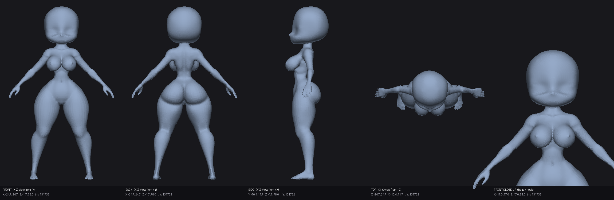

# Chibi

Единая модель, собранная из тела из Blender и отдельной STL-головы.

## Исходные файлы

- `body base.blend` — тело с отдельной шеей и арматурой.
- `Chibi_head.stl` — голова в формате binary STL.

## Готовая модель

- **`Chibi_full_fused.stl`** — основная единая модель: одна замкнутая
  watertight-поверхность после voxel-remesh. Этот файл удобнее всего
  использовать как цельную модель, в том числе для 3D-печати.
- `Chibi_full.blend` — один объединённый mesh-объект в Blender с сохранённой
  исходной геометрией тела и головы.
- `Chibi_full.stl` — STL объединённого mesh-объекта без voxel-remesh.
- `Chibi_full.glb` — GLB-версия объединённой модели для просмотрщиков.
- `Chibi_full_report.json` — размеры, количество вершин/полигонов и параметры
  сборки.
- `preview/Chibi_full_fused_views.png` — виды спереди, сзади, сбоку, сверху и
  крупный план головы/шеи.



## Улучшенная версия с текстурой кожи

- **`Chibi_pretty.glb`** — рекомендуемая красивая версия: увеличенная плотность
  и мягко сглаженная поверхность, запечённая текстура светлой кожи и карта
  шероховатости уже встроены в файл.
- `Chibi_pretty.blend` — та же модель для Blender; внутри один mesh-объект,
  UV-развёртка, слой вершинной росписи `SkinPaint` и упакованные текстуры.
- `Chibi_pretty.stl` — высококачественная замкнутая watertight-геометрия для
  печати и других 3D-инструментов. Сам формат STL не хранит цвет и текстуры.
- `textures/skin_basecolor.png` — базовая карта кожи 2048×2048 с мягким
  градиентом, розовыми щёчками, носиком, губами и веками.
- `textures/skin_roughness.png` — карта шероховатости 1024×1024.
- `Chibi_pretty_report.json` — параметры скульптинга, запекания и геометрии.
- Превью: [спереди](preview/Chibi_pretty_front.png),
  [в три четверти](preview/Chibi_pretty_threequarter.png) и
  [крупный план](preview/Chibi_pretty_closeup.png).

Поверхность `Chibi_full_fused.stl` проходит повторный voxel-remesh с размером
вокселя `0.20`, затем мягкое скульптурное сглаживание. Итоговая модель содержит
149 884 вершины и 299 764 треугольника и остаётся одной замкнутой
watertight-поверхностью. Кожа сделана из вершинной росписи и процедурного
материала с очень мелкими порами и мягким подповерхностным рассеянием, после
чего запечена в PNG-текстуры.


## Как пересобрать в GitHub Actions

### Базовая единая модель

1. Откройте вкладку **Actions**.
2. Выберите **Build unified Chibi model**.
3. Нажмите **Run workflow**.
4. При необходимости измените параметры:
   - `head_scale` — масштаб головы, по умолчанию `0.60`;
   - `voxel_size` — размер вокселя для слитой STL, по умолчанию `0.30`;
   - `commit_results` — записывать ли готовые файлы обратно в выбранную ветку.

Workflow скачивает официальный Blender 4.2.0, запускает
`scripts/merge_chibi.py`, проверяет STL и создаёт превью. Все файлы также
доступны как artifact завершённого запуска.

### Улучшенная версия с текстурой кожи

1. Откройте вкладку **Actions**.
2. Выберите **Build pretty textured Chibi model**.
3. Нажмите **Run workflow**.
4. При необходимости измените параметры:
   - `voxel_size` — плотность и гладкость поверхности, по умолчанию `0.20`;
   - `texture_size` — размер запечённой карты кожи, по умолчанию `2048`;
   - `bake_samples` — количество Cycles-сэмплов при запекании, по умолчанию `8`;
   - `render_samples` и `render_width` — качество и ширина Cycles-превью;
   - `commit_results` — записывать ли готовые файлы обратно в выбранную ветку.

Workflow запускает `scripts/enhance_chibi.py`, проверяет, что итоговая STL
остаётся одной замкнутой поверхностью, а GLB содержит встроенные текстуры,
создаёт три превью и загружает все результаты как artifact.

## Сборка локально

### Базовая модель

```bash
blender --background --factory-startup -noaudio \
  --python scripts/merge_chibi.py -- \
  --body "body base.blend" \
  --head Chibi_head.stl \
  --out-dir . \
  --head-scale 0.60 \
  --voxel-size 0.30
```

Голова в исходном STL смотрит в противоположную телу сторону, поэтому при
сборке она поворачивается на 180° вокруг оси Z и ставится на ось шеи с
небольшим перекрытием, чтобы на стыке не было щели.

### Улучшенная версия с текстурой кожи

После создания `Chibi_full_fused.stl` выполните:

```bash
blender --background --factory-startup -noaudio \
  --python scripts/enhance_chibi.py -- \
  --input Chibi_full_fused.stl \
  --out-dir . \
  --voxel-size 0.20 \
  --texture-size 2048 \
  --bake-samples 8 \
  --render-samples 32 \
  --render-width 800
```

> В готовых моделях поза тела «запечена»: это статичные модели без арматуры и
> vertex groups. Исходный риг по-прежнему находится в `body base.blend`.
